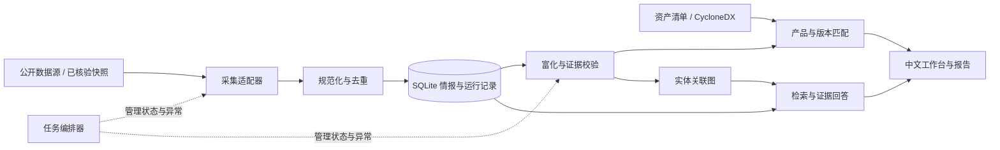

# 观澜技术设计

## 1. 目标与使用场景

服务安全研究员和 AI 应用运维人员。研究员从分散公告中检索风险，运维人员把风险关联到已知资产，两者共享证据记录和处置建议。设计优先保证本地部署、可复现处理过程和结论可追溯。

当前离线版不依赖 LLM 推理服务。关键词检索、字段比对和版本关系属于确定性能力；需要复杂语义理解的开放域问题仍是升级方向。

## 2. 总体结构

### 关键选型

|选择|原因|边界|
|---|---|---|
|Node.js 内置 HTTP|普通电脑可运行，部署依赖少|不是多进程高可用服务|
|SQLite|事务持久化、便于复制和离线演示|大规模并发写入需另行评估|
|原生 HTML/CSS/JS|离线资源完整，没有外部 CDN|复杂前端可在后续迭代引入框架|
|确定性检索与领域词扩展|可解释、无需下载模型、延迟较低|不等于向量语义检索|
|可选兼容模型接口|支持后续接入实际模型服务|模型性能和正确率需重新测量|

## 3. 任务编排

流程拆分为规划、采集、规范化、富化、关联、验证和报告步骤。每步记录运行状态、耗时、输入/输出计数或日志。来源失败不能直接转成成功，部分来源可用时保留部分结果和失败原因。

本地默认模式采用确定性工作流与角色分工。它提供可审计的工具调用骨架；真正由 LLM 自主选择工具、规划及反思的能力必须在接入模型并测试之后单独证明，不能通过给步骤起 Agent 名称替代。

### 扩展协议

采集器输出统一的情报记录，后续新增数据源只需要适配记录协议。富化器只追加有证据的字段，未知字段保留为空或“待核验”。新任务状态可追加但应保持旧记录可读。

## 4. 情报模型与证据

每条记录包括标识、类型、标题、来源 URL、发布日期、采集时间、产品、风险标签、CVSS、版本范围、修复建议与证据。证据保存摘要、来源链接和 SHA-256。哈希用于判断快照内容是否变化，不能证明来源真实，也不是数字签名。

漏洞、论文、标准、政策按不同类型处理。非漏洞资料不填写没有依据的 CVSS。风险规则分仅表示可解释的来源优先级，不是经过校准的置信概率，更不是系统准确率。

### 富化维度

1. 产品及版本区间：来自厂商公告或漏洞库的结构化依据。
2. 严重程度和风险分类：保留评分来源，规则分类单独展示。
3. 关联资料：按产品和主题连接论文、标准及分析资料，关联不代表因果证明。
4. 公开验证参考：仅索引来源中出现的参考链接，未经核验不标注为有效 PoC。
5. 资产影响：对导入资产进行产品和版本匹配。
6. 修复建议：来自原始公告的升级信息及对应防护建议。
7. 证据完整性：来源、摘要、采集时间、哈希和待确认字段。

## 5. 资产匹配

版本按数值分段比较，避免 `0.1.9 > 0.1.34` 的字符串排序错误。固定修复版本采用上界排除；只有末个受影响版本时采用上界包含。匹配返回 `affected`、`not_affected` 或 `unknown`。

未知版本、预发布后缀和缺少结构化区间不能武断归为安全。多个版本区间有任一区间命中即标受影响。匹配范围只对应已入库公告，不代表发现全部漏洞。教学资产是虚构清单，不是已扫描互联网资产。

## 6. 问答与拒答

检索优先定位明确 CVE 和产品名，中文词项与领域同义词用于扩展召回。显式询问不存在的 CVE 时直接返回证据不足，防止把相似编号当成答案。回答保留来源引用和实际执行的检索步骤。

多文档答案应列出每项结论的出处。与提问无关、超出语料覆盖或要求泄露服务端配置的问题不应产生编造的结论。外部文档是数据，不能成为工具调用或权限扩张指令。

后续接入向量召回、重排序、多跳计划和 LLM 时，必须保留本地基线，做相同测试集上的对照。可解释信息应是证据、工具调用和结果摘要，不是模型隐式思维过程。

## 7. 工程边界

本地 HTTP 请求限制 JSON 体积，对外部来源使用超时和有限响应大小。服务端提供静态目录白名单，避免访问源代码、数据库和环境文件；跨来源写请求被拒绝。

定时监测仅在服务运行期间执行。轮询间隔不能直接证明采集延迟达标，还要考虑上游更新延迟、限流、网络故障和系统停机。API 无认证，本地单用户使用，公网发布需单独设计访问控制。

## 8. 可重复验证

系统测试覆盖数据筛选、图边完整性、受影响/已修复版本对照、SBOM 导入、问答引用、未知问题拒答、离线幂等执行和跨来源写保护。开发集保存逐题结果、来源命中及实际响应时间。

要评价比赛要求的准确率，应建立独立金标准并冻结语料版本。富化以“漏洞—字段—证据”的具体关系为样本，问答按答案正确性、引用支持性、覆盖率和拒答分别评分。不能把 HTTP 200、存在引用或七题测试通过当作问答准确率 95%。
